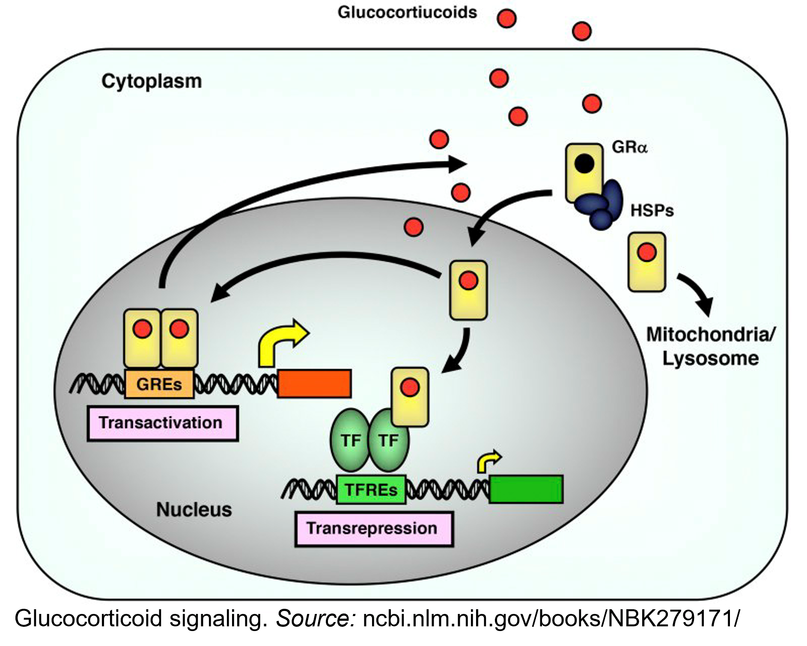
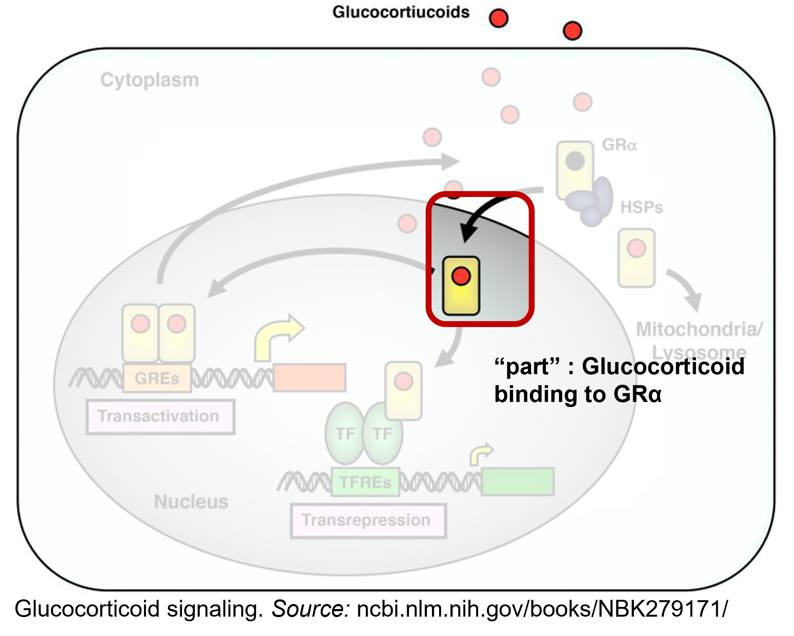
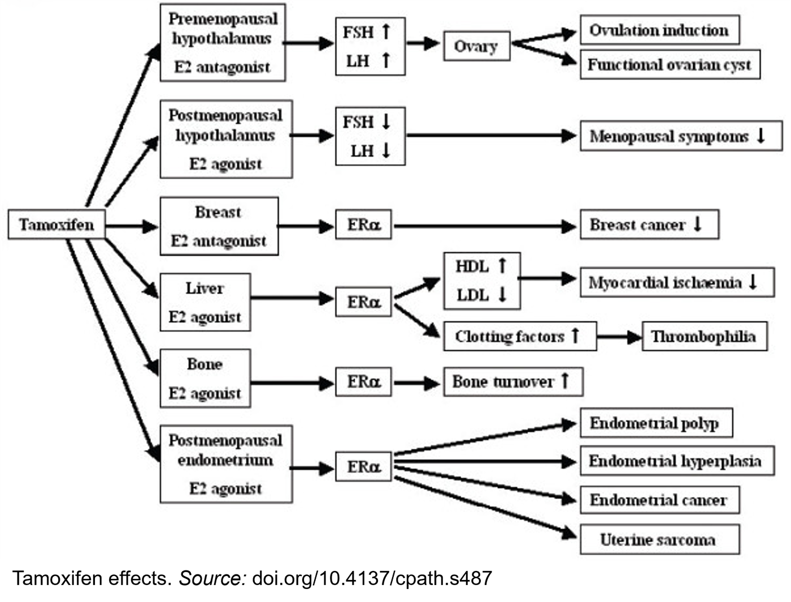
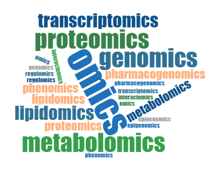
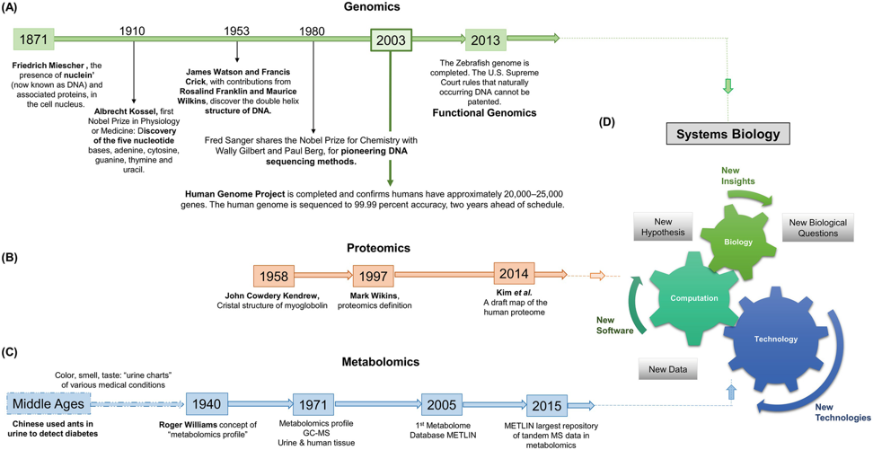
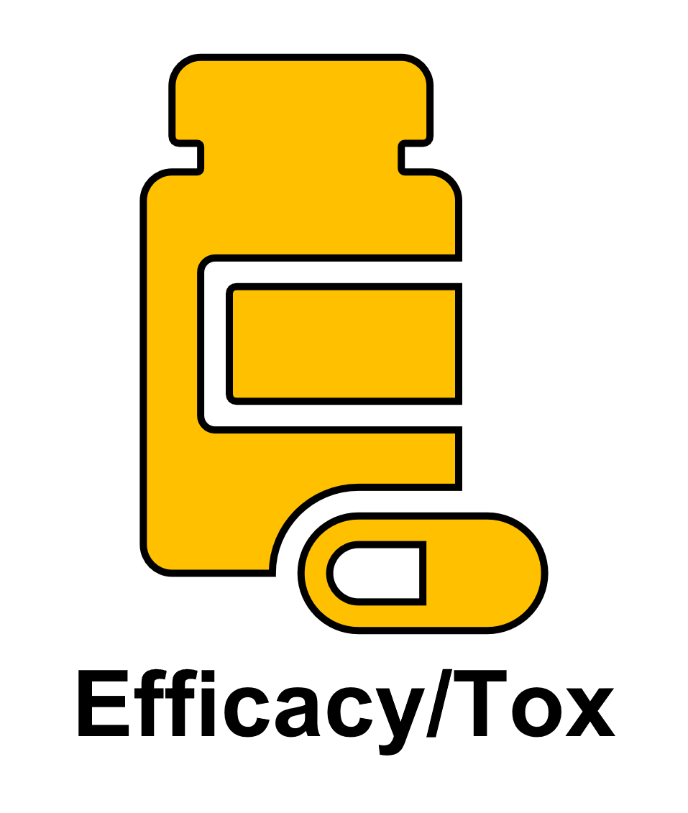
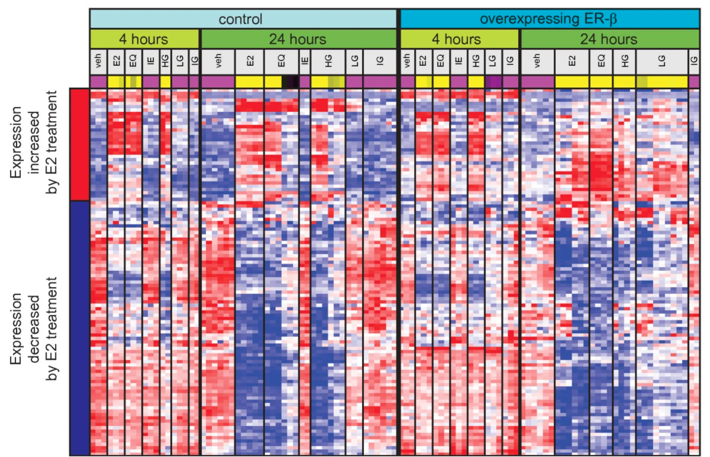
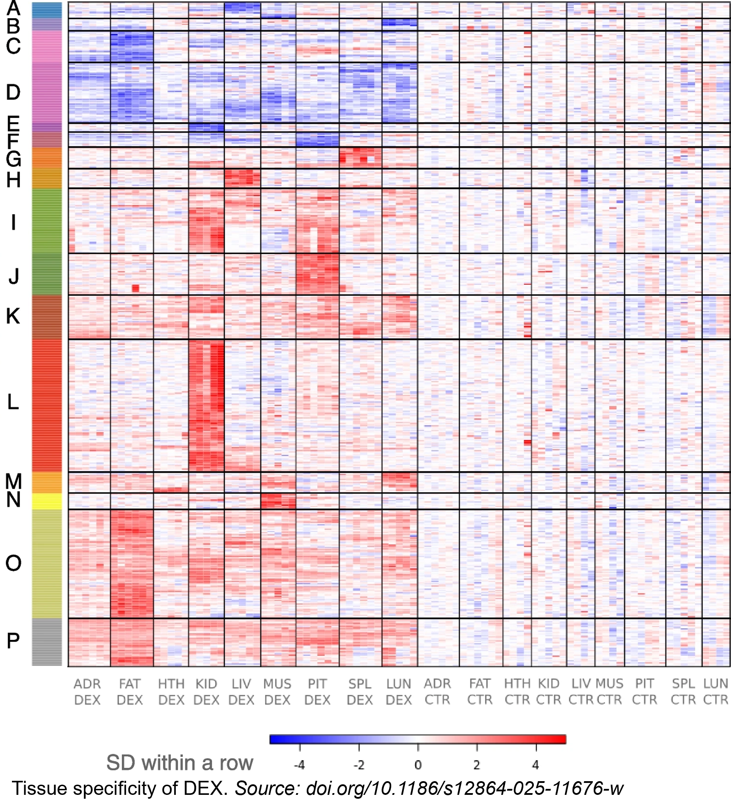
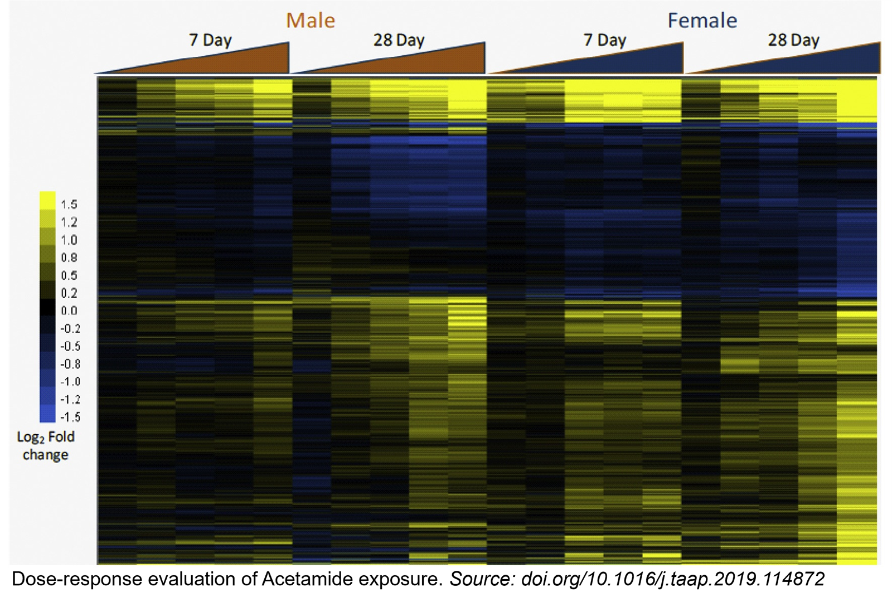
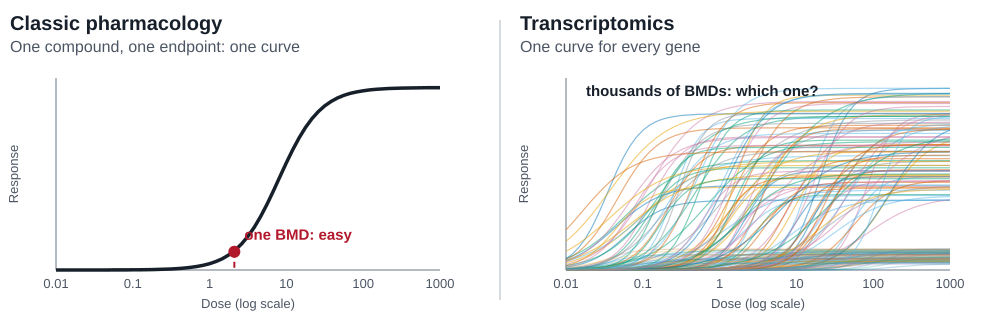

## DECLARING THE USE OF AI

::: statement
*All material and contents were developed and created by Rance Nault. Generative AI was used to convert traditional lecture slides into interactive lessons with the goal of enhancing the learning experience.*
:::

## LEARNING OBJECTIVES

 By the end of this lecture you should be able to:

- Distinguish systems biology, systems pharmacology, and systems toxicology.
- Interpret ‘omic’ signatures of disease states and drug responses.
- Use ‘omic’ signatures to identify drug targets and mechanisms of action.
- Evaluate drug efficacy and safety using systems pharmacology approaches.

<!-- ======================================================================
     SECTION 1 — INTRO TO SYSTEMS            (activity: LO 1)
     ====================================================================== -->

## WHAT IS SYSTEMS PHARMACOLOGY?

::::: columns
:::: {.column width="48%"}
 Systems pharmacology is the integration of <b>systems biology</b> and <b>pharmacodynamics</b> used to investigate the interaction of drugs, biology, and disease.

- <a href="https://irp.nih.gov/catalyst/19/6/systems-biology-as-defined-by-nih" target="_blank">"... ask five biomedical researchers to define systems biology, and you'll get 10 different answers... or maybe more."</a>
- At its simplest, biology is examined at a larger scale looking at the overall network instead of individual parts.
::::

:::: {.column .tall-figure width="52%"}
{data-id="gr-image" fig-alt="Diagram of glucocorticoid signaling in a cell. Glucocorticoids enter the cell and bind GR-alpha, which is held in the cytoplasm by heat shock proteins (HSPs). The ligand-bound receptor moves into the nucleus, where it binds glucocorticoid response elements (GREs) to turn genes on (transactivation) or interacts with other transcription factors to turn genes off (transrepression)." fig-align="center"}
::::
:::::

::: source-credit
Source: <a href="https://www.ncbi.nlm.nih.gov/books/NBK279171/" target="_blank" rel="noopener">NCBI Bookshelf NBK279171</a>
:::

## WHAT IS SYSTEMS PHARMACOLOGY?

::::: columns
:::: {.column width="48%"}
 Systems pharmacology is the integration of <b>systems biology</b> and <b>pharmacodynamics</b> used to investigate the interaction of drugs, biology, and disease.

- <a href="https://irp.nih.gov/catalyst/19/6/systems-biology-as-defined-by-nih" target="_blank">"... ask five biomedical researchers to define systems biology, and you'll get 10 different answers... or maybe more."</a>

- At its simplest, biology is examined at a larger scale looking at the overall <b>network</b> instead of individual <b>parts</b>.
::::

:::: {.column .tall-figure width="52%"}
{data-id="gr-image" fig-alt="The same glucocorticoid signaling diagram with everything faded except one highlighted step labeled 'part': glucocorticoid binding to GR-alpha. This shows the single molecular event inside the larger network." fig-align="center"}
::::
:::::

::: source-credit
Source: <a href="https://www.ncbi.nlm.nih.gov/books/NBK279171/" target="_blank" rel="noopener">NCBI Bookshelf NBK279171</a>
:::

## WHY THE NETWORK MATTERS

 Simplification of mechanisms and target evaluations play a key role in drug development and safety testing, but biology is complex - <b>drugs and responses are dependent on the biological context.</b>

- Are pathways independent from each other or will they cross-talk?

- Does cellular context drive differences in how the individual *parts* interact?

## WHY THE NETWORK MATTERS - TAMOXIFEN

::::: columns
:::: {.column width="33%"}
 Tamoxifen is an <u>ERα antagonist in breast tissue</u>, but acts as a <u>partial agonist in bone and endometrium</u>. Because it acts through the same receptor everywhere, these are tissue-specific effects and they account for both benefits and risks when it is used to treat breast cancer. 
::::

:::: {.column .tall-figure .figure-short width="67%"}
{data-id="tam-image" fig-alt="Flow diagram of tamoxifen's tissue-specific actions, all through ER-alpha. It acts as an estradiol (E2) antagonist in the breast (breast cancer decreases) and premenopausal hypothalamus, but as an E2 agonist in the postmenopausal hypothalamus, liver (HDL up, LDL down, clotting factors up, thrombophilia), bone (bone turnover), and postmenopausal endometrium (polyp, hyperplasia, endometrial cancer, uterine sarcoma)." fig-align="center"}
::::
:::::

::: source-credit
Source: <a href="https://doi.org/10.4137/cpath.s487" target="_blank" rel="noopener">doi.org/10.4137/cpath.s487</a>
:::

## HOW TO *"DO"* SYSTEMS PHARMACOLOGY

  Systems pharmacology is technology-driven. One of the major reasons it hasn't always been used as part of pharmacological research is that we didn't have the tools yet.

- How do we measure the changes in the network?

- How do we predict and model changes in the network? 

## HOW TO *"DO"* SYSTEMS PHARMACOLOGY

  Systems pharmacology is technology-driven. One of the major reasons it hasn't always been used as part of pharmacological research is that we didn't have the tools.

- How do we measure the changes in the network? <b>"Omics"</b>

- How do we predict and model changes in the network? <b>Computational & statistical modeling, machine learning, *artificial intelligence?*</b>

  Working with these types of big data required novel strategies and perspectives.

## ACTIVITY: Systems Biology, Pharmacology, and Toxicology

::: activity-embed-controls
<button onclick="EmbedBridge.reloadIframe(this)">

↻ Reset this activity

</button>
:::

::: activity-embed
<iframe class="activity-iframe" loading="lazy" title="Systems Biology, Pharmacology and Toxicology activity" src="../activities/systems-pharm-network/index.html?seed=4200">

</iframe>
:::

::: notes
Have students turn on "systems approach" alone first — network grows, but both organs still look identical. Then turn on "pharmacology approach" too — same drug, same receptor, but each organ now highlights a different downstream pathway. That's the punchline: neither approach alone explains organ-specific outcomes. Finally turn on "toxicology approach" — dexamethasone appears even if pharmacology is off (toxicology is about harm from the drug), and each organ gains an adverse endpoint (fatty liver; delayed wound healing) in yellow. With systems on you also see the genes behind the liver endpoint; with systems off you only see that the outcome happens, not why.
:::

<!-- ======================================================================
     SECTION 2 — SYSTEMS AND SIGNATURES
                 (activities: LO 2 = Omic Signatures, LO 3 = Mode of Action)
     ====================================================================== -->

## TRANSCRIPTOMICS

 The emergence of **transcriptomics** can be considered one of the primary drivers of systems approaches.  Today, "omics" - "Areas of biological study defined by the investigation of the [entire complement\*]{.underline} of a [specific type of biomolecule]{.underline}" has expanded well beyond the transcriptome.

::::: columns
::: {.column width="66%"}
- [**Gen**]{.underline}**omics:** DNA and genomic features

- [**Epigen**]{.underline}**omics:** Chromatin and other epigenetic features

- [**Transcript**]{.underline}**omics:** RNA expression

- [**Prote**]{.underline}**omics:** Protein levels

- [**Metab**]{.underline}**olomics:** Metabolite levels

- ...
:::

::: {.column width="34%"}
{fig-alt="A text blob that shows dozens of different omics including lipidomics, pharmacogenomics, phenomics, regulomics, and more." fig-align="center"}
:::
:::::

::: slide-footnote
*\*Note: it is almost never truly an entire complement. All technologies have biases.*
:::

::: source-credit
Source: <a href="https://rd-connect.eu/what-we-do/omics/" target="_blank" rel="noopener">RD-Connect</a>
:::

## A BRIEF HISTORY OF 'OMICS'

 

{fig-alt="A timeline figure showing the history of omics technologies." fig-align="center"}

::: credit-spacer
:::

::: source-credit
Source: <a href="https://doi.org/10.1007/978-3-030-77252-9_1" target="_blank" rel="noopener">da Silva Zandonadi et al. (2021) Adv Exp Med Biol</a>
:::

## SYSTEMS PHARMACOLOGY IN PRACTICE

<!-- Each card jumps to a slide by its id (the {#...} after a heading below).
     Signatures and Mechanisms share the same destination on purpose: they are
     taught together and share the LO 2 + LO 3 activities. To send Mechanisms
     straight to the Mode of Action activity instead, change its target to
     #/s-moa. Efficacy/safety goes to the dose-response block (LO 4). -->

::: practice-cards
<button type="button" class="practice-card" onclick="location.hash='#/s-signatures'" aria-label="Signatures — go to gene expression signatures">

</button>

<button type="button" class="practice-card" onclick="location.hash='#/s-signatures'" aria-label="Mechanisms — go to gene expression signatures and mode of action">

</button>

<button type="button" class="practice-card" onclick="location.hash='#/s-dose-response'" aria-label="Efficacy and safety — go to dose-response modeling">

</button>
:::

## GENE EXPRESSION SIGNATURES {#s-signatures}

  Gene expression signatures represent the overall pattern of transcript expression, or changes in expression, that represent the state of a system.

- Diseases will commonly have <u>distinct patterns of gene expression changes</u> that represent a pathological condition.

- Drugs, based on their mode-of-action, will also cause <u>distinct patterns of gene expression changes</u>.

 

::: text-center
The use of these signatures for understanding biology is largely founded on the *"central dogma"* of biology
:::

## THE <i>CENTRAL DOGMA</i> OF BIOLOGY

  The central dogma suggests that RNA is representative of the overall protein levels and downstream phenotypes. 

{.nostretch fig-alt="Diagram of the central dogma of molecular biology: DNA is transcribed into RNA, and RNA is translated into protein." fig-align="center" width="624px"}

::: source-credit
Source: <a href="https://personal.cityu.edu.hk/liangdai/post/central-dogma-translation-transcription/" target="_blank" rel="noopener">personal.cityu.edu.hk/liangdai</a>
:::

## DIFFERENT DRUGS, SIMILAR SIGNATURES

::::: columns
:::: {.column width="33%"}
Similarity in gene <i>'omic'</i> signatures tends to reflect that the drugs have a common target. For example, we can see that many estrogenic compounds have shared groups of induced and repressed genes, but they are not always a perfect copy of each other.
::::

:::: {.column width="67%"}
{fig-alt="Red-and-blue gene expression heatmap comparing control cells with ER-beta overexpressing cells at 4 and 24 hours. Columns are vehicle and several estrogenic treatments; rows are split into genes increased versus decreased by estradiol (E2). The estrogenic treatments show similar red/blue patterns to E2, unlike vehicle." fig-align="center"}
::::
:::::

::: source-credit
Source: <a href="https://doi.org/10.1186/1471-2105-12-381" target="_blank" rel="noopener">Gower, Spira & Lenburg (2011) BMC Bioinformatics</a>
:::

## SAME DRUG, DIFFERENT SIGNATURES?

::::: columns
:::: {.column width="33%"}
Conversely, signatures can also reveal how different gene regulatory networks that exist in different organs, tissues, or cells can lead to very different gene expression changes for the same drug.
::::

:::: {.column .tall-figure width="67%"}
{fig-alt="Red-and-blue gene expression heatmap comparing effects of dexamethasone across tissues of male C57BL/6 mice." fig-align="center"}
::::
:::::

::: source-credit
Source: <a href="https://doi.org/10.1186/s12864-025-11676-w" target="_blank" rel="noopener">Piechota et al. (2025) BMC Genomics</a>
:::

## ACTIVITY: Understanding 'Omic Signatures (LO 2)

::: activity-embed-controls
<button onclick="EmbedBridge.reloadIframe(this)">

↻ Reset this activity

</button>
:::

::: activity-embed
<iframe class="activity-iframe" loading="lazy" title="Understanding &#39;Omic Signatures activity" src="../activities/omic-signatures/index.html?seed=2026">

</iframe>
:::

::: notes
Three-step wizard: (1) predict whether the unclustered heatmap shows real signatures, reveal via live hierarchical clustering — 8 pairs come out clean; (2) the 8 reference groups are read as diseases (two samples each) and one new patient sample is added; students predict which disease it is most similar to, reveal shows the real Pearson correlation (never a perfect match); (3) the 8 reference groups are read as diseases and a drug signature (the inverse of one of them) is added; students predict which disease the drug would most likely be effective against — reveal shows the most anti-correlated disease, introducing the connectivity-map idea that an inverse signature is itself informative.
:::

## ACTIVITY: Mode of Action Discovery (LO 3) {#s-moa}

::: activity-embed-controls
<button onclick="EmbedBridge.reloadIframe(this)">

↻ Reset this activity

</button>
:::

::: activity-embed
<iframe class="activity-iframe" loading="lazy" title="Mode of Action Discovery activity" src="../activities/mode-of-action/index.html?seed=2026">

</iframe>
:::

::: notes
Ten compounds, 48 genes, hierarchically clustered on both axes. The colored bar beside the heatmap annotates each gene with the receptor it is a known target of (GR, ER, PPARα, AhR, PXR, or no annotation), so genes regulated by the same receptor appear as colored blocks. The two starred compounds are a pair; students decide which receptor they act through by looking at which block the pair switches on, compare with the other compounds, then lock in an answer. Click a receptor chip to highlight its genes. The reveal tests the genes changed in both compounds for over-representation of each receptor's target set (Fisher's exact test, as in the enrichment activity) and points out any cross-talk: some compounds weakly nudge a second receptor, so real signatures are never perfectly clean. A new seed changes which pair is starred, the compounds' numbers, the cross-talk and the noise.
:::

<!-- ======================================================================
     SECTION 3 — MAPPING GENES TO MECHANISMS + DOSE-RESPONSE MODELING
                 (activity: LO 4 — evaluate efficacy and safety)

     DRAFT PLACEHOLDERS. Every slide below is a first-pass outline: the text
     is a starting point and each dashed box marks a figure still to be made.
     Search this file for PLACEHOLDER to find them all.

     The "Efficacy and safety" card on the hub slide jumps straight to the
     dose-response half (#s-dose-response). The original demo slides and
     activities you may want to borrow from are in lectures/_parking-lot.qmd.
     ====================================================================== -->

## MAPPING GENES TO MECHANISMS {#s-annotation}

 A signature is a list of genes. A *mechanism* or *mode of action* is a story about what those genes do together. **Functional annotation** connects the two by asking which biological functions or pathways are over-represented among the genes that changed.

- Gene sets come from curated resources (e.g., Gene Ontology, Reactome, KEGG, MSigDB Hallmark).
- A pathway "hit" is a hypothesis about mechanism, not proof of it.

::: {.fragment .definition-popup}
### Mechanism vs. mode of action

**Mechanism:** <b>How</b> the drug is acting at the biochemical level, such as binding, gene expression changes, etc...

**Mode of action:** <b>What</b> the drug is doing at the broader level in the system or cells (e.g., anti-inflammatory).
:::

## OVER-REPRESENTATION OR RANKED?

 Two common ways to test whether a pathway is enriched:

- **Over-representation** (what you used in the Mode of Action activity): take the genes that passed a cutoff and ask whether a pathway has more of them than chance would give.
- **Ranked methods (e.g., GSEA)**: use every measured gene, ordered by how much it changed, with no cutoff.
- The **background** must be the genes you actually measured, and testing thousands of gene sets needs **multiple-testing correction**

## ACTIVITY: Over-Representation or Ranked?

::: activity-embed-controls
<button onclick="EmbedBridge.reloadIframe(this)">

↻ Reset this activity

</button>
:::

::: activity-embed
<iframe class="activity-iframe" loading="lazy" title="Over-Representation or Ranked? activity" src="../activities/enrichment-methods/index.html?seed=3030">

</iframe>
:::

::: notes
Twenty genes are ranked from most induced to most repressed, and each carries a pathway tag (Path 1, 2 or 3). Students look at the ranking alone and lock in which pathway they think is enriched. The reveal then runs both methods on the same data. Over-representation uses only the boxed genes (top 4 and bottom 4) in a Fisher's exact test against the 20-gene background. The ranked method walks down the whole list: each pathway gene steps a running total up, each other gene steps it down, so an enriched pathway makes a "hockey stick" at one end. The permutation p-value compares that score with random gene sets of the same size. Every seed has exactly one truly enriched pathway; a new seed reshuffles which one it is and where its genes fall.
:::

## TRANSCRIPTOMIC APPROACH TO SAFETY AND EFFICACY {#s-dose-response}

::::: columns
:::: {.column width="33%"}
 A signature tells you *what* changed at one dose. Efficacy and safety are questions of *how much drug* it takes.
::::

:::: {.column .tall-figure .figure-short width="67%"}
{data-id="acetamide-image" fig-alt="A heatmap of dose-response gene expression profiling of acetamide." fig-align="center"}
::::
:::::

::: source-credit
Source: <a href="https://doi.org/10.1016/j.taap.2019.114872" target="_blank" rel="noopener">doi.org/10.1016/j.taap.2019.114872</a>
:::

## IDENTIFYING A POINT OF DEPARTURE FROM GENE EXPRESSION

 In safety and efficacy testing we typically rely on a measurement describing some level of <i>effect</i>. In toxicology we often call this the <b>point of departure</b>. In pharmacology this measurement is commonly the <b>minimum effective dose/concentration</b>. 

- Use of gene expression profiling for chemicals and drugs are predominantly focused on safety rather than efficacy since we usually measure the efficacy through more targeted means (we know the expected therapeutic effect). 

## ONE CURVE IS EASY. THOUSANDS ARE NOT.

{.nostretch fig-alt="Left: a single dose-response curve with one benchmark dose marked. Right: a tangle of many dose-response curves, one for every gene, with many different benchmark doses." fig-align="center" width="780px"}

- **Which genes count?** Keep only curves that fit well and respond within the tested doses.
- **How do we boil thousands of benchmark doses down to one?** The lowest gene? A percentile? A pathway?
- **Which summary can we defend?** Group genes by pathway, test for enrichment, and anchor the estimate in mechanism.

## ACTIVITY: From Gene Curves to a Dose (LO 4)

::: activity-embed-controls
<button onclick="EmbedBridge.reloadIframe(this)">

↻ Reset this activity

</button>
:::

::: activity-embed
<iframe class="activity-iframe" loading="lazy" title="From Gene Curves to a Dose activity" src="../activities/pathway-point-of-departure/index.html?seed=5150">

</iframe>
:::

::: notes
Three steps. Step 1: 80 genes, each with its own dose-response curve and its own benchmark dose (BMD), the dose where its curve crosses the response threshold; click the pathway chips to isolate each group. Step 2: the BMDs grouped by pathway, with a dose slider. At each dose the genes that have responded are tested for enrichment (same Fisher's exact test as the previous activity). Point out that the oxidative stress pathway is enriched first (it is small but every gene responds at low dose), that lipid biosynthesis only becomes enriched at higher doses, that a pathway can lose enrichment once many other genes respond, and that Cell cycle never becomes enriched even though it is a real pathway, because its few responders are scattered. Step 3 has no question: it lists ten established ways to turn gene BMDs into a point of departure (percentiles of gene BMDs, the lowest gene, pathway-level medians and percentiles, the most sensitive process, and BMDL-based versions), computed on this dataset and plotted on one dose axis. They spread over one to three orders of magnitude. Discuss why: the lowest gene is an outlier or an adaptive response, gene-level percentiles ignore mechanism, and pathway-level estimates depend on which pathways qualify. The last row anchors the estimate in mechanism: the median BMD of the enriched pathway linked to the adverse outcome (lipid biosynthesis and steatosis), compared with the efficacy dose (GR targets) to give the window. Each seed changes the doses and the width of the window.
:::

## PUTTING IT TOGETHER

 Four objectives, four activities:

- **LO 1** — Systems, pharmacology, and toxicology approaches answer different questions about the same drug.
- **LO 2** — A signature is a pattern across many genes, and similar patterns suggest similar biology. However, the biological context matters and the same drug can produce very distinct signatures in different contexts. 
- **LO 3** — Genes driving a shared signature can be mapped to pathways to propose a mode of action or mechanism. 
- **LO 4** — Collapse gene-level dose-response curves into the median benchmark dose of an enriched, mechanism-linked pathway to weigh efficacy against safety.

Next lecture: what changes when we measure **single cells** and **tissue space** instead of a whole-tissue average.

## About this material

